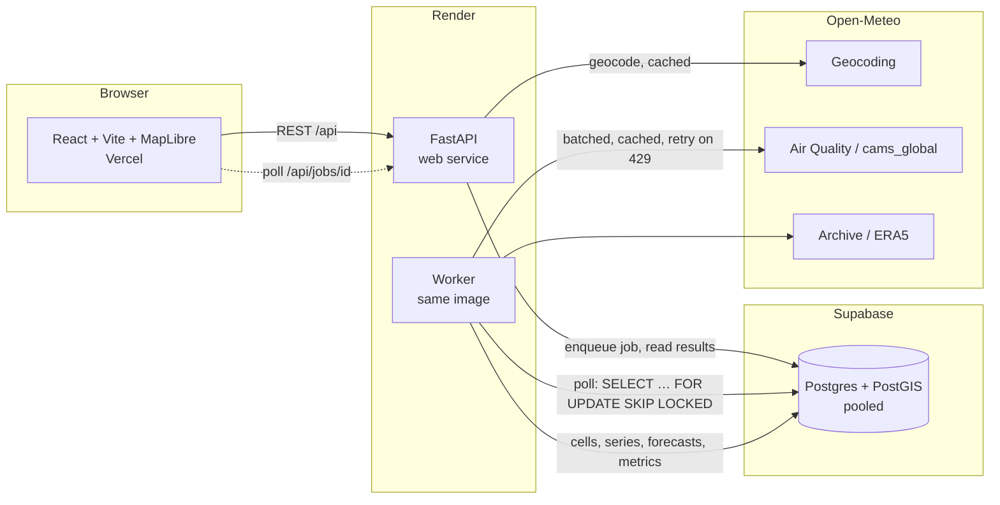

# Carbon Emission Hotspot Monitor — MVP Plan

Status: **plan only, no code written yet.** Waiting for your answers to §9.

Sources read in full: `emission-hotspot-dashboard.html` (prototype, all 668 lines) and
`ISPRS_Research_Paper.pdf` (all 32 pages).

Paper: R. Y. Sonawane & S. Murugavelh, *"AI-Driven Climate Intelligence: Spatio-Temporal
Framework for Carbon Emission Hotspot Detection and Prediction"* (VIT Vellore). The PDF has
no venue/year/DOI on its pages, so the README citation will say "preprint" unless you give
me the details.

---

## 1. What is being built

A web app where a user enters a place or `lat, lon`, and a background job:

1. Fetches CAMS hourly NO₂/CO/CH₄/SO₂ (history + 5-day forecast) and ERA5 weather from Open-Meteo.
2. Runs the prototype's pipeline per grid cell: daily means → MAD clip → Kalman fill →
   Savitzky–Golay → robust z-score → GWP-weighted CEI → p2–p98 scale → k-means (k=4) classes.
3. Trains a shared BiLSTM (60-day window → 30-day output, chained), evaluates on a 60-day
   holdout against linear-trend and persistence baselines, fine-tunes, forecasts with 20 MC-dropout passes.
4. Stores everything in Postgres/PostGIS, serves it over a REST API, and a React/MapLibre
   frontend renders the map, inspector, charts and tables. `/r/<id>` loads a cached analysis.

### Prototype vs paper (MVP follows the prototype; paper = later upgrade)

| Area | Prototype (MVP) | Paper (later) |
|---|---|---|
| Gas source | CAMS global via Open-Meteo (~0.4°, ~45 km) | TROPOMI L2 at 3.5×5.5 km → stub behind `ENABLE_TROPOMI` |
| Compositing | Daily means (≥4 valid hours) | Monthly pixel-wise median |
| Classes | k-means on cell-month CEI | k-means labels **train** a SegFormer-B4; classes come from the net |
| Forecaster | 1-layer BiLSTM, 16 units, direct 30-day output | 2-layer BiLSTM, 128 units, LayerNorm, AdamW, 24→12 months |
| Inputs | CEI + sin/cos(day-of-year) | 13 channels (gases, 5 ERA5 vars, 3 land-use, CEI) |
| Attribution | Exact Shapley of the linear CEI vs regional mean | DeepSHAP on the network |
| Masking / validation | none | FIRMS fire mask, CARB/EDGAR cross-check |
| Eval | 60-day temporal holdout, all cells | + spatial holdout, "temporal consistency" score |
| Uncertainty | MC dropout σ | same; paper calls long horizons *scenarios* — UI copy keeps that wording |

---

## 2. Architecture



Job pipeline (worker steps, each updating `jobs.step/progress/log`):
`grid → fetch_history → fetch_cams_forecast → fetch_weather → preprocess+CEI → classify →
persist_map → train_holdout → evaluate → finetune → forecast → persist_forecast → done`.
The map is viewable and the job marked `partial` after `persist_map` so users see results
before the LSTM finishes (prototype does the same).

### Repo layout (all new, under `carbon-hotspot-monitor/`)
```
carbon-hotspot-monitor/
  PLAN.md  README.md  DEPLOY.md  docker-compose.yml  render.yaml  .env.example
  api/                       # Python package "hotspot", one image for api + worker
    pyproject.toml  uv.lock  Dockerfile  alembic.ini  alembic/versions/
    src/hotspot/
      main.py  config.py  schemas.py  errors.py  ratelimit.py
      routes/{geocode,analyses,jobs,health}.py
      db/{engine.py, queries.py}
      sources/{openmeteo.py, cache.py, tropomi.py (stub)}
      pipeline/{timeseries.py, cei.py, kmeans.py, attribution.py, grid.py, run.py}
      ml/{bilstm.py, windows.py, baselines.py, metrics.py, forecast.py}
      worker.py
    tests/{unit, integration, fixtures, js_parity}
  web/                       # React + Vite + TS, Dockerfile (nginx), vercel.json
  .github/workflows/ci.yml   # (see §9 Q1 re: repo root)
```
Dependencies kept minimal: FastAPI, Pydantic v2, httpx, numpy, pandas, scikit-learn, torch (CPU),
SQLAlchemy 2 (Core) + psycopg 3, Alembic, ruff, black, pytest, respx. **No** GeoAlchemy2
(raw `ST_GeomFromGeoJSON`), **no** Redis, **no** scipy (SG filter is 7 constants).

---

## 3. Database schema (Alembic `0001`; first statement `CREATE EXTENSION IF NOT EXISTS postgis`)

| Table | Columns (key ones) |
|---|---|
| `regions` | `id`, `name`, `lat`, `lon`, `geom geometry(Point,4326)`; unique on rounded `(lat,lon)` |
| `analyses` | `id uuid`, `region_id`, `params jsonb` (radius_km, grid, months, horizon, weighting, epochs), `params_hash text` (index; 24 h reuse), `status`, `created_at`, `finished_at`, `summary jsonb` (gases used, days, date range, norm stats `med/scale` per gas, `lo/hi/span`, k-means `centroids/class_idx/thresholds`, wind r), `metrics jsonb` (3 models × rmse/mae/r2/mape, n holdout days), `data_notes jsonb[]` (e.g. "methane not served") |
| `cells` | `id`, `analysis_id`, `row`, `col`, `lat`, `lon`, `geom geometry(Polygon,4326)` + GiST index |
| `cell_timeseries` | `cell_id`, `day date`, `series text` (`history` \| `cams`), `cei real`, `nitrogen_dioxide`, `carbon_monoxide`, `methane`, `sulphur_dioxide` (normalized z-scores, nullable); PK `(cell_id, series, day)` |
| `forecasts` | `cell_id`, `horizon_day int`, `day date`, `mean real`, `std real`; PK `(cell_id, horizon_day)` |
| `weather_daily` | `analysis_id`, `day`, `temperature_2m`, `wind_speed_10m`, `precipitation`, `surface_pressure` |
| `jobs` | `id uuid`, `analysis_id`, `status` (`queued/running/partial/succeeded/failed`), `step`, `progress int`, `log jsonb` (list of `{t, level, msg}`), `error jsonb`, `locked_by`, `heartbeat_at`, `attempts`, timestamps |
| `api_cache` | `key text pk` (sha256 of URL), `url`, `status int`, `body jsonb`, `fetched_at`, `expires_at`; TTLs: history 30 d, forecast 3 h, ERA5 30 d, geocode 7 d |

Storage choice: a row per (cell, day) is ~50k rows for the largest run (64 cells × 730 d);
bulk-inserted with `COPY`/`executemany`. Per-view values (month means, last-30-day mean,
class) are computed from these rows on request, not stored — keeps one source of truth.
Model weights are **not** stored (per your spec).

Jobs table claim query (worker): `UPDATE jobs SET status='running', locked_by=…
WHERE id = (SELECT id FROM jobs WHERE status='queued' ORDER BY created_at
FOR UPDATE SKIP LOCKED LIMIT 1) RETURNING *`. Stale `running` jobs (no heartbeat for 5 min) are re-queued once, then failed.

---

## 4. API contract (FastAPI OpenAPI at `/docs`)

Errors always `{"error": {"code": "...", "message": "what happened", "hint": "what to do"}}`.

| Endpoint | Notes |
|---|---|
| `GET /api/geocode?q=` | `lat,lon` parsed locally; otherwise Open-Meteo geocoding (cached). Returns up to 5 `{name, lat, lon, admin1, country}`; 404 with a hint if none. |
| `POST /api/analyses` | Body `{lat, lon, name, radius_km 50–500, grid 3–8, months 6–24, horizon ∈{30,90,180}, weighting ∈{gwp,flat}, epochs}` → `{analysis_id, job_id, reused: bool}`. Reuses a succeeded/partial/running analysis with identical `params_hash` from the last 24 h. Per-IP limit (default 6/hour, env-configurable; in-memory sliding window, honours `X-Forwarded-For` from Render) → 429 + `Retry-After`. |
| `GET /api/jobs/{id}` | `{status, step, progress, log[], error}` |
| `GET /api/analyses/{id}` | summary, k-means thresholds, metrics, data-availability notes, gases used, date range, views available (`cams`, `proj`) |
| `GET /api/analyses/{id}/map?view=now\|month\|cams\|proj&month=YYYY-MM` | GeoJSON `FeatureCollection`; per feature `{cell_id, class (0–3), class_name, cei, sigma (proj only), top_gas}` + collection-level `legend` counts |
| `GET /api/analyses/{id}/cells/{cell_id}?view=…&month=…` | `{series, region_mean, cams, projection:{mean,std}, thresholds, attribution:[{gas,label,sector,phi,share_pct}]}` |
| `GET /api/analyses/{id}/weather` | monthly table (mean CEI, temp, wind, rain) + `{wind_r, wind_note}` |
| `GET /healthz` | process + DB ping |

Frontend routes: `/` (new analysis), `/r/:id` (cached, shareable; polls job if not finished).
Field names (`nitrogen_dioxide`, `cei`, `class`, …) are identical in DB, API and UI types.

---

## 5. ML/pipeline port checklist (every item exists in the prototype)

| Function | Prototype lines | Behaviour that must be preserved |
|---|---|---|
| `hourly_to_daily` | 192–201 | UTC date key; mean only if ≥4 finite hours else null |
| `clip_outliers` | 204–208 | median/MAD(×1.4826); \|x−m\|>4s → median; no-op if s≤0 |
| `kalman_fill` | 211–224 | robust-standardise, Q=1e-4, R=1e-2, P₀=1, start at first finite, skip update on gaps, de-standardise |
| `sg_smooth` | 227–235 | window 7 quadratic `[-2,3,6,7,6,3,-2]/21`, **edge-clamp** (not scipy's mirror), n<7 passthrough |
| robust stats / z-score | 240, 482 | per gas over all cells × days |
| `compute_cei` | 243–253 | `w·(gwp if mode=="gwp" else 1)/Σw` |
| scaling | 484–486 | p2/p98 over all cells × days, `(v−lo)/(hi−lo)`, no clipping |
| cell-month means → k-means | 497–499 | k=4, k-means++, 10 restarts, seed 42, centroids sorted, k capped to #unique values, `class_idx` spread if k<4 |
| `classify` | 283 | nearest centroid → `class_idx` |
| attribution | 549–557 | per-gas `w·gwp/Σw·(cellMean−regionMean)/span` over the view's day set; shown as % of positive total |
| windows / BiLSTM / forecast | 286–334 | WIN=60, OUT=30, features `[cei, sin, cos]` of day-of-year/365.25, stride 3, Adam 5e-3, batch 64, dropout .15/.1, dense 32 ReLU, 10 % validation split, chained blocks, 20 MC passes |
| metrics | 336–341 | RMSE, MAE, R², MAPE skipping \|actual\|<0.05 |
| baselines | 342–349, 519–520 | linear trend over last 90 d before cut-off; persistence = mean of 7 d before cut-off |
| holdout flow | 510–526 | last 60 d held out → train → eval (dropout off) → fine-tune `max(2, round(epochs/4))` epochs on all data → forecast |
| weather | 470–477, 645–650 | ERA5 `models=era5` with fallback; precipitation ×24; wind–CEI Pearson r with the ±0.3 wording |

**Python tests**
- Hand-computed unit tests for every function above (small arrays I can verify on paper; I'll show the arithmetic in the test).
- Exact-Shapley test: the closed form is compared against brute-force subset enumeration (Eq. 19) to prove it *is* exact for the linear CEI.
- **JS-parity test**: extract prototype lines 175–283 + 336–349 verbatim into `tests/js_parity/prototype_core.js` (no `tf`/DOM), run with Node on a fixed seeded synthetic input, compare to Python. Preprocessing/CEI/scaling/metrics/baselines/attribution: `atol=1e-9`. k-means: the prototype uses its own mulberry32 RNG while the spec requires sklearn's, so seeds cannot match; on well-separated synthetic data I compare **sorted centroids to atol 1e-6 and identical class assignments**, and say so in the test docstring.
- Integration tests: FastAPI `TestClient` + real Postgres/PostGIS (service container in CI) + `respx` mocking httpx with recorded fixtures — see §9 Q3 about how fixtures get recorded.
- LSTM test: tiny config (2 epochs, hidden 4) checks shapes, determinism with a fixed seed, MC std > 0, and that metrics are reported even when a baseline wins.

---

## 6. Frontend plan

React + Vite + TS, MapLibre GL, Recharts (to replace Chart.js; threshold bands via `ReferenceArea`, projection band via stacked `Area`). Copy, layout, view buttons, month slider, inspector, top-6 list, eval table, weather table, run log and footer text are taken from the prototype verbatim except where the "in your browser" wording is no longer true (the lede and footnote are updated to "on our server").
- Basemap: CARTO Positron/Dark Matter raster tiles, switches with the theme toggle (prototype only follows OS; I'll add a manual toggle, default = OS).
- Per panel: skeleton while loading, explicit empty state, and error state with the API's `hint`.
- A11y: visible focus rings, `prefers-reduced-motion`, colour + text for classes (prototype already prints the class name), `aria-live` status.
- Mobile: single-column under 900 px as in the prototype; map height as in prototype.
- Checks: `tsc --noEmit`, eslint, prettier, Vitest + Testing Library smoke test (renders form, mocks API, shows legend).

---

## 7. Milestones

| M | Scope | Done when |
|---|---|---|
| **M1** | Scaffold, `uv` project, docker-compose (PostGIS + api + worker + web), Alembic `0001`, `/healthz`, ruff/black/eslint/prettier configs | `docker compose up` brings up all services; `/healthz` green; migration up/down clean |
| **M2** | `sources/openmeteo` (batching, backoff, `api_cache`), `pipeline/*`, `tropomi` stub, all unit + JS-parity tests | `pytest` green offline |
| **M3** | Jobs table + worker, all endpoints, rate limit, 24 h reuse, integration tests | Full job runs end-to-end on fixtures; OpenAPI complete |
| **M4** | Frontend map/inspector/views/polling/share URL/themes | Works against local API |
| **M5** | BiLSTM, holdout + baselines, MC dropout, metrics in API/UI | Training < ~60 s on small CPU at default settings (measured and reported) |
| **M6** | Dockerfiles for prod, `render.yaml`, `vercel.json`, CI, `DEPLOY.md`, README (Python-for-Java section, attributions) | CI green; DEPLOY steps written against the actual configs |

I commit after each milestone and report what works, what doesn't, and assumptions.

---

## 8. Risks I already see

1. **Resolution mismatch.** CAMS global is ~0.4° (~45 km). Grids finer than that (e.g. 50 km radius × 8×8 = 12 km cells) will have many neighbouring cells returning *identical* data, so "hotspots" there are an artefact. The prototype has the same issue. Plan: compute effective cell size, show a visible warning on the analysis when cells are < ~45 km, and (after verifying against real responses) dedupe requests to unique CAMS cells to cut API weight.
2. **Open-Meteo free-tier limits** (rate and daily weighted quota; also non-commercial terms). 8×8 grid × 24 months is the heavy case. Mitigation: the `api_cache`, 5-point batches as in the prototype, backoff on 429, and a clear error when the daily quota is hit. A deployed app serving the public may need Open-Meteo's commercial plan — I'll note this in DEPLOY.md.
3. **Methane availability** in `cams_global` history is unverified from here. The prototype's fallback (drop gas, record a note) is ported; I'll also show it in the UI notes panel.
4. **Scaling leaks the holdout.** The prototype computes robust-z and p2–p98 stats over the *whole* record, including the 60 held-out days. The effect is small but it is mild leakage. MVP preserves this for parity with the prototype and the JS test; I'd document it in the README and the metrics note, and fix it (fit on pre-cutoff days only) as a follow-up.
5. **Training time/memory on a small instance.** Windows are ~(cells × (T−60−30−60)/3) ≈ 64 × 190 ≈ 12k for the largest run; should fit in ~60 s but unmeasured until M5. PyTorch CPU runtime alone is ~300 MB RSS, which is near Render's 512 MB free/starter limit.
6. **Supabase pooler.** The transaction pooler (port 6543) doesn't support prepared statements → psycopg `prepare_threshold=None`. Alembic migrations need the direct or session-mode connection (separate `DATABASE_URL_MIGRATIONS`). Documented in DEPLOY.md.
7. **Render free tier:** web services sleep after inactivity (first request ~30–60 s). **Background workers have no free plan.** See Q4.
8. **CORS for Vercel previews:** "Vercel domain only" means preview URLs (`*-git-branch-*.vercel.app`) will be blocked unless added to `CORS_ORIGINS`. I'll make it an explicit comma-separated env list, no wildcard.
9. **Prototype oddity (kept):** missing CAMS-forecast values are set to 0 in z-space before CEI (line 490), which biases forecast-view CEI toward the regional median when data is missing. I'll port it and flag in a code comment; changing it is a one-line follow-up.

---

## 9. Open questions (need your answer before M1)

1. **Where does this live?** The repo you opened (`hardik884/opassure`) is an unrelated project (CAT machinery operator assistant, with its own `CLAUDE.md`, CI and branching rules). I put this plan in `carbon-hotspot-monitor/` inside it so nothing existing is touched. Do you want that, or a **new, empty repo** (recommended — CI, `render.yaml` and `vercel.json` all want the repo root)? I can't create a repo outside the scoped one without you adding it. I have *not* committed or pushed anything.
2. **Network access for this session.** Right now outbound calls to `*.open-meteo.com` are denied by the sandbox policy (403 at the proxy), so I could not look at a real API response. Please allow `air-quality-api.open-meteo.com`, `archive-api.open-meteo.com`, `geocoding-api.open-meteo.com` (and `download.pytorch.org` for the CPU wheel, plus Docker Hub if you want me to run `docker compose` here) in the environment's network settings. I haven't checked whether Docker's daemon is usable here either; I'll test that at M1 and tell you.
3. **Test fixtures.** You asked for *recorded* upstream fixtures. Without Q2 I can't record any, and I won't hand-write fake "recorded" data. If Q2 is granted I record real responses (small windows, committed under `tests/fixtures/`). If not, I'll build clearly named `synthetic_*` fixtures that only match the documented response *shape*, label them as such, and the tests will say so — but then I also can't show you a real-data end-to-end run until you run it yourself.
4. **Worker hosting.** Render background workers are paid (Starter, ~$7/mo). Options: (a) paid Render worker — matches your spec; (b) run the worker loop inside the free API web service as a background thread — free but jobs die when the service sleeps/restarts and memory is tight; (c) Fly.io/other. **Recommendation:** (a) for the worker, free tier for the API. I'll write `render.yaml` that way unless you say otherwise.
5. **ML library:** I'll use plain PyTorch (`nn.LSTM(bidirectional=True)`) as specified. Fine?
6. **Citation details:** do you have the venue/year/DOI for the paper? Otherwise the README says "preprint, VIT Vellore".
7. **Python version:** you asked for 3.12; the sandbox has 3.13. `uv` can pin 3.12 but may need to download it (also network-dependent). I'll pin 3.12 in `pyproject.toml`/Dockerfile and use whatever works locally for dev.

Stopping here until you've looked at this.
